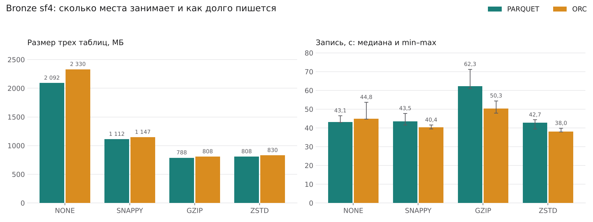
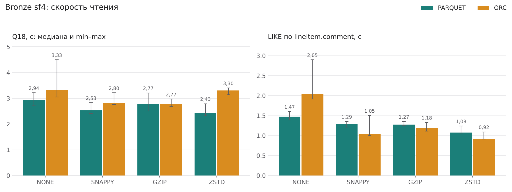

# Практическая работа №1. Локальный Lakehouse, ELT и бенчмарк форматов хранения

**Вариант 3: TPC-H Q18 "Large Volume Customer".** Стек: MinIO + Lakekeeper (Iceberg REST) + Trino 476, BI на Apache Superset.

Стенд я прогнал целиком 14.10.2026 одним запуском `./run_all.sh`. Все числа ниже взяты из файлов в [`results/`](results). Рядом с каждой таблицей указано, из какого файла она взята, чтобы цифру можно было найти. Сводку по всем замерам собирает [`tools/summary.py`](tools/summary.py) в [`results/summary.md`](results/summary.md).

**Коротко о результатах.** Q18 по сырому Bronze выполняется за 2,4 с. Если брать готовый агрегат из Silver, выходит 0,36 с, с сортировкой 0,19 с, а витрина Gold отвечает за 0,04 с. Для хранения выбрал Parquet + ZSTD: Bronze занимает 808 МБ против 2 092 МБ без сжатия, и в Parquet это самый быстрый вариант для Q18. GZIP дает еще на 2,5 % меньше, но пишется на 46 % дольше.

## Содержание

1. [Вариант и масштаб](#1-вариант-и-масштаб)
2. [Поднятые сервисы и почему именно они](#2-поднятые-сервисы-и-почему-именно-они)
3. [Разбор запроса: какие данные нужны](#3-разбор-запроса-какие-данные-нужны)
4. [Медальон: решения по каждому слою](#4-медальон-решения-по-каждому-слою)
5. [Тесты производительности](#5-тесты-производительности)
6. [Часть 2: осмысление и работа с инструментами](#6-часть-2-осмысление-и-работа-с-инструментами)
7. [Выводы](#7-выводы)

---

## 1. Вариант и масштаб

| Поле | Значение |
|---|---|
| ФИО (как в VK Education) | Оробинский Дмитрий Александрович |
| Вариант (запрос) | Q18 "Large Volume Customer" (вариант 3) |
| Масштаб `sfN` | **sf4** |
| Почему выбрал такой масштаб | Я сравнил три соображения. **1) Чтобы `LIMIT 100` реально что-то отбирал.** Под условие Q18 (в заказе больше 300 единиц товара) на sf1 попадает всего 57 заказов, поэтому топ-100 возвращает их все, и проверить сортировку и отсечение нельзя. На sf4 таких заказов 249 ([`results/validation.md`](results/validation.md)), то есть отсекается больше половины. **2) Чтобы была нагрузка.** На sf4 в `lineitem` 23 996 604 строки, а группировка идет по 6 000 000 заказам. Q18 по Bronze занимает 2,4-3,3 с, и разница между форматами в объеме чтения и в процессоре уже видна. **3) Чтобы влезло в ноутбук.** После всего прогона в бакете 10,9 ГБ (слои и восемь вариантов Bronze), самый тяжелый запрос (построение `fact_orders`) занял 1 395 МБ памяти, а у Docker всего 7,6 ГБ. На sf10 данных стало бы в 2,5 раза больше, и восемь вариантов Bronze на мой диск уже не поместились бы. Минус выбора: на таком объеме время Q18 почти не зависит от кодека (раздел 5.3). |

## 2. Поднятые сервисы и почему именно они

Все описано в [`docker-compose.yml`](docker-compose.yml), версии образов вынесены в [`.env`](.env). Список контейнеров после прогона (`docker compose --profile bi ps -a`, файл [`results/docker_ps.txt`](results/docker_ps.txt)):

```text
NAME                     IMAGE                               STATUS
q18-lakekeeper           quay.io/lakekeeper/catalog:v0.9.0   Up About an hour (healthy)
q18-lakekeeper-init      curlimages/curl:8.11.1              Exited (0) 3 minutes ago
q18-lakekeeper-migrate   quay.io/lakekeeper/catalog:v0.9.0   Exited (0) 3 minutes ago
q18-minio                bitnamilegacy/minio:2025.4.22       Up About an hour
q18-minio-init           bitnamilegacy/minio:2025.4.22       Exited (0) 3 minutes ago
q18-postgres             postgres:17.5                       Up About an hour (healthy)
q18-superset             q18-superset:4.1.2                  Up 6 minutes (healthy)
q18-trino                trinodb/trino:476                   Up About an hour (healthy)
```

Работают пять сервисов. Healthcheck проходят Trino, Lakekeeper, PostgreSQL и Superset, у MinIO проверка в compose не задана. Три init-контейнера отработали и вышли с кодом 0. Они перезапускаются при каждом `docker compose run toolbox`, поэтому у них время выхода "3 минуты назад", а у сервисов около часа.

| Сервис | Роль в стеке | Почему именно он (а не альтернатива) |
|---|---|---|
| **MinIO** (`q18-minio`, образ `bitnamilegacy/minio:2025.4.22`) | Объектное хранилище с S3 API. Бакет `tpch-lake`, в нем parquet/orc-файлы и метаданные Iceberg | Это самый простой способ получить настоящий S3 локально: Trino, pyarrow и Superset работают с ним так же, как с облачным хранилищем. Хранилище отделено от вычислений: Trino можно перезапустить или заменить, данные останутся. Образ `minio/minio` у меня не скачался, поэтому взял сборку Bitnami с тем же сервером (RELEASE.2025-04-22). |
| **PostgreSQL 17.5** (`q18-postgres`) | База, где Lakekeeper хранит состояние каталога | Lakekeeper работает поверх PostgreSQL. Коммит в Iceberg переставляет указатель на новый `metadata.json`, и в PostgreSQL это делается транзакцией. Поэтому две одновременные записи не потеряют снапшоты друг друга. |
| **Lakekeeper v0.9.0** (`q18-lakekeeper`) | Iceberg REST Catalog, warehouse `q18wh` | Реализует открытый REST-протокол Iceberg, так что к одному каталогу можно подключить и Trino, и Spark, и PyIceberg, и DuckDB. Hive Metastore тянет за собой Hadoop и Thrift. Nessie интересен ветками данных, но в этой работе ветки не нужны. Lakekeeper один бинарник, поднимается за секунды. |
| **Trino 476** (`q18-trino`) | SQL-движок: строит слои, гоняет бенчмарк, делает операции Iceberg | Читает и пишет Iceberg прямо в S3. В `CREATE TABLE AS` можно задать формат, кодек, сортировку и партиции. Поддерживает `MERGE`, time travel и метатаблицы `$files`/`$snapshots`, по которым я считаю размеры. Встроенный коннектор `tpch` сам генерирует данные любого масштаба, ничего не нужно скачивать. |
| **Superset 4.1.2** (`q18-superset`) | BI: SQL Lab по Bronze и дашборд по Gold | Подробно в разделе 6.2. |
| **toolbox** (`q18-toolbox`, `python:3.12-slim`) | Скрипты ELT, бенчмарка, части 2 и сводки | Клиент `trino` берет время и статистику запроса с сервера. `pyarrow` открывает сами файлы в MinIO и читает их футеры (кодек, row group, min/max). |

Как компоненты связаны между собой:

| Кто | К кому | Как |
|---|---|---|
| Trino (каталог `tpch`) | генератор TPC-H | данные создаются на лету, источник для `CREATE TABLE AS` |
| Trino (каталог `iceberg`) | Lakekeeper | REST: где лежит текущий `metadata.json` таблицы, коммит новых снапшотов |
| Trino, toolbox | MinIO | S3: запись и чтение parquet/orc, чтение футеров |
| Lakekeeper | PostgreSQL | состояние каталога и warehouse |
| Superset | Trino | SQLAlchemy `trino://superset@trino:8080/iceberg` |

### Скрипты, которыми поднимал стек

```bash
docker compose up -d                                 # minio, postgres, lakekeeper (+ migrate и init), trino
docker compose build toolbox                         # образ со скриптами
docker compose --profile bi up -d --build superset   # BI
./run_all.sh                                         # все шаги подряд: ELT, часть 2, бенчмарк, Superset, сводка
```

| Контейнер | Назначение |
|---|---|
| `q18-minio` | сервер MinIO, порты 9000 (S3) и 9001 (консоль), том `minio-data` |
| `q18-minio-init` | `mc mb --ignore-existing s3/tpch-lake` создает бакет и завершается |
| `q18-postgres` | PostgreSQL для каталога, том `pg-data` |
| `q18-lakekeeper-migrate` | `lakekeeper migrate` разворачивает схему базы каталога |
| `q18-lakekeeper` | `lakekeeper serve`, порт 8181 |
| `q18-lakekeeper-init` | `POST /management/v1/bootstrap` и `POST /management/v1/warehouse` с [`conf/lakekeeper/warehouse.json`](conf/lakekeeper/warehouse.json) |
| `q18-trino` | Trino, порт 8080. Каталоги лежат в [`conf/trino/catalog/`](conf/trino/catalog), лимит памяти на запрос 3 ГБ задан в [`conf/trino/config.properties`](conf/trino/config.properties) |
| `q18-superset` | Superset, порт 8088. При старте создает админа и подключение `Trino / Iceberg` |

Каталог Iceberg в Trino ([`conf/trino/catalog/iceberg.properties`](conf/trino/catalog/iceberg.properties)):

```properties
connector.name=iceberg
iceberg.catalog.type=rest
iceberg.rest-catalog.uri=http://lakekeeper:8181/catalog
iceberg.rest-catalog.warehouse=q18wh
iceberg.file-format=PARQUET
iceberg.compression-codec=ZSTD
fs.native-s3.enabled=true
s3.endpoint=http://minio:9000
s3.path-style-access=true
```


## 3. Разбор запроса: какие данные нужны

Q18 ищет оптовые заказы. Для каждого заказа суммируется `quantity` по всем его позициям, остаются заказы с суммой больше 300, из них берутся 100 самых дорогих по `totalprice`, и к каждому подтягивается клиент.

| Таблица TPC-H | Нужные колонки | Что запрос с ними делает (фильтр / джойн / агрегат / вывод) |
|---|---|---|
| `lineitem` | `orderkey`, `quantity` | агрегат `sum(quantity) GROUP BY orderkey` считается два раза: в подзапросе с `HAVING > 300` и во внешнем запросе для вывода. По `orderkey` идет джойн с `orders` |
| `orders` | `orderkey`, `custkey`, `orderdate`, `totalprice` | фильтр `orderkey IN (подзапрос)`, джойн с `lineitem` и `customer`, сортировка `totalprice DESC, orderdate`, вывод |
| `customer` | `custkey`, `name` | джойн по `custkey`, вывод имени клиента |

Что из этого следует для хранения:
- В Q18 нет фильтра по дате, стране или сегменту. Значит, `lineitem` читается целиком и партиции ничего не отсекут.
- Из 16 колонок `lineitem` нужны две, обе числовые. В Parquet + ZSTD они занимают 33,2 МБ из 623 МБ таблицы (раздел 5.3). Поэтому формат должен быть колоночным.
- Самая дорогая часть запроса, `sum(quantity)` по 24 млн строк, от запуска к запуску не меняется. Ее можно посчитать один раз в Silver.

## 4. Медальон: решения по каждому слою

| Слой | Таблицы | Откуда | Что делает |
|---|---|---|---|
| Bronze | `region`, `nation`, `customer`, `orders`, `lineitem` | `tpch.sf4` | копия источника + `_load_id`, `_loaded_at` |
| Silver | `dim_customer` | `customer` + `nation` + `region` | клиент со страной и регионом, без дублей |
| Silver | `fact_orders` | `orders` + агрегат `lineitem` | одна строка на заказ, `sorted_by total_quantity` |
| Silver | `bulk_orders` | `fact_orders` + `dim_customer` | заказы с `total_quantity > 300` (подзапрос Q18) |
| Gold | `q18_answer` | `bulk_orders` | ответ на Q18, 100 строк |
| Gold | `bulk_orders_by_year` | `fact_orders` + `dim_customer` | оптовые заказы по годам, сегментам, регионам |
| Gold | `order_qty_histogram` | `fact_orders` | распределение заказов по объему, шаг 25 |

SQL лежит в [`sql/01_bronze.sql`](sql/01_bronze.sql), [`sql/02_silver.sql`](sql/02_silver.sql), [`sql/03_gold.sql`](sql/03_gold.sql). Выполняет его [`tools/pipeline.py`](tools/pipeline.py), он же после загрузки пишет [`results/layers.csv`](results/layers.csv), время шагов, проверки качества и сверку Gold. Строки считаются через `count(*)`, вес как сумма `file_size_in_bytes` из `$files` (только файлы данных), кодек читается из футера самого большого файла каждой таблицы.

Общие решения для всех слоев:
- **Формат Parquet, кодек ZSTD, таблицы Iceberg.** Parquet потому, что Q18 берет 2 колонки из 16 и в Parquet тратит меньше процессора, чем в ORC. ZSTD выбран по итогам бенчмарка (раздел 5): Bronze в 2,59 раза меньше несжатого, всего на 2,5 % больше, чем с GZIP, а пишется на 46 % быстрее GZIP.
- **Партиционирования нет нигде.** Q18 читает все годы и все заказы, отсекать по партициям нечего, а дробление по дате только наплодило бы мелких файлов. Фильтр `total_quantity > 300` я ускоряю сортировкой в Silver (раздел 4.2).

### Bronze (сырой)

Данные лежат так, как пришли из источника, плюс две служебные колонки: `_load_id` (какой запуск ELT их загрузил) и `_loaded_at` (когда). По `_loaded_at` Silver при дедупликации оставляет самую свежую версию строки.

| Таблица | Колонки (что оставил) | Строк | Вес, МБ | Формат | Сжатие | Партиционирование | Обоснование |
|---|---|---:|---:|---|---|---|---|
| `iceberg.bronze.region` | все 3 + 2 служебные | 5 | 0,001 | PARQUET | ZSTD | нет | Справочник регионов, нужен для обогащения клиента в Silver. |
| `iceberg.bronze.nation` | все 4 + 2 служебные | 25 | 0,002 | PARQUET | ZSTD | нет | Справочник стран, один маленький файл. |
| `iceberg.bronze.customer` | все 8 + 2 служебные | 600 000 | 32,67 | PARQUET | ZSTD | нет | В Q18 нужен только для джойна, читается целиком. |
| `iceberg.bronze.orders` | все 9 + 2 служебные | 6 000 000 | 152,39 | PARQUET | ZSTD | нет | Отбор в Q18 идет по `orderkey IN (...)`, а не по диапазону, так что партиции не помогли бы. |
| `iceberg.bronze.lineitem` | все 16 + 2 служебные | 23 996 604 | 622,93 | PARQUET | ZSTD | нет | Самая большая таблица. Колонки не урезаю: Bronze это копия источника, она пригодится и для других запросов. Колоночный формат все равно дает читать только нужные 2 колонки. |

Итого Bronze занимает 808,0 МБ в 24 файлах данных (`lineitem` 12, `orders` 8, `customer` 2, справочники по одному). В футере самого большого файла каждой таблицы записан кодек `ZSTD` ([`results/layers.csv`](results/layers.csv)). Загрузка `lineitem` заняла 34,3 с, `customer` 12,4 с, `orders` 9,4 с ([`results/pipeline_steps.csv`](results/pipeline_steps.csv)).


### Silver (очищенный)

Что делается при переходе из Bronze в Silver:

| Шаг | Как сделано |
|---|---|
| Очистка | отбрасываются строки с пустыми ключами и датами, `quantity <= 0`, `extendedprice <= 0`, `discount`/`tax` вне [0; 1]. Позиции без заказа и заказы без позиций отсекает inner join. Дубли клиентов убирает `row_number() ... = 1` по `_loaded_at` |
| Нормализация | деньги и количество из `DOUBLE` переводятся в `DECIMAL`, чтобы суммы были точными, текстовые коды проходят через `upper(trim())` |
| Обогащение | у клиента появляются страна и регион. По каждому заказу считаются `lines_cnt`, `total_quantity`, `gross_amount`, `net_amount`, `returned_cnt`, `last_receiptdate`. Флаг `price_ok` проверяет, что `totalprice` сходится с суммой позиций по формуле TPC-H `sum(extendedprice * (1 - discount) * (1 + tax))` с допуском 0,021 на позицию (про допуск ниже) |

| Таблица | Колонки (что оставил) | Строк | Вес, МБ | Формат | Сжатие | Партиционирование | Обоснование |
|---|---|---:|---:|---|---|---|---|
| `iceberg.silver.dim_customer` | `custkey, cust_name, address, phone, acctbal, mktsegment, nation, region` | 600 000 | 22,74 | PARQUET | ZSTD | нет | Клиент сразу со страной и регионом, витринам не нужно каждый раз джойнить справочники. |
| `iceberg.silver.fact_orders` | `orderkey, custkey, orderdate, order_year, orderstatus, orderpriority, totalprice, lines_cnt, total_quantity, gross_amount, net_amount, price_ok, returned_cnt, last_receiptdate` | 6 000 000 | 137,52 | PARQUET | ZSTD | нет; вместо партиций `sorted_by = total_quantity` и row group 8 МБ | Главная таблица работы. `sum(quantity)` по 24 млн позиций считается здесь один раз, и Q18 дальше работает с 6 млн готовых строк. Сортировка по `total_quantity` и маленькие row group дают каждому row group узкий диапазон min/max, и фильтр `> 300` Trino проверяет по статистике, не читая данные. Читать приходится 6 row group из 34, это 551 658 строк из 6 000 000 ([`results/fact_orders_rowgroups.csv`](results/fact_orders_rowgroups.csv)). |
| `iceberg.silver.bulk_orders` | `orderkey, custkey, cust_name, mktsegment, nation, region, orderdate, order_year, totalprice, total_quantity, lines_cnt` | 249 | 0,007 | PARQUET | ZSTD | нет | Подзапрос Q18, сохраненный отдельной таблицей: оптовые заказы вместе с клиентом. 249 строк в одном файле 7,3 КБ. |

**Как выглядит `fact_orders` на диске.** Trino записал таблицу шестью параллельными писателями, получилось шесть файлов. Сортировка действует внутри каждого файла, а не по всей таблице. Самый большой файл: 2 512 846 строк, 14 row group:

| № row group | Строк | min(`total_quantity`) | max(`total_quantity`) |
|---:|---:|---:|---:|
| 0 | 242 576 | 1 | 26 |
| 1 | 186 606 | 26 | 39 |
| 2 | 186 567 | 39 | 51 |
| ... | ... | ... | ... |
| 11 | 186 596 | 167 | 189 |
| 12 | 186 592 | 189 | 237 |
| 13 | 31 153 | 237 | 328 |

Значения больше 300 есть только в последнем row group каждого файла. В остальных файлах картина та же, отличается только размер хвоста: от 31 153 строк в самом большом файле до 142 821 строки в четвертом. Самый маленький файл (85 743 строки) состоит из одного row group с диапазоном от 1 до 316, его читать приходится целиком. Построение `fact_orders` заняло 34,1 с: прочитано 29 996 604 строки (весь `lineitem` и `orders`), пик памяти 1 395 МБ. `dim_customer` построился за 7,3 с, `bulk_orders` за 1,1 с.

Почему row group 8 МБ. При размере row group по умолчанию (128 МБ) в каждом файле `fact_orders` был бы один row group на весь диапазон от 1 до 300 с лишним, и статистика min/max ничего бы не отсекала. Поэтому для Silver размер задается сессионным свойством `parquet_writer_block_size = 8MB` ([`tools/pipeline.py`](tools/pipeline.py)).


**Проверки качества** ([`results/dq_checks.csv`](results/dq_checks.csv)):

| Проверка | Результат |
|---|---:|
| строк в `bronze.lineitem` | 23 996 604 |
| `lineitem`: `orderkey IS NULL` | 0 |
| `lineitem`: позиций с `quantity <= 0` | 0 |
| `lineitem`: позиций с `extendedprice <= 0` | 0 |
| `lineitem`: скидка или налог вне [0; 1] | 0 |
| `lineitem`: позиций без заказа | 0 |
| строк в `bronze.orders` | 6 000 000 |
| `orders`: заказов без позиций | 0 |
| строк в `silver.fact_orders` | 6 000 000 |
| `fact_orders`: `price_ok = false` | 0 |
| `fact_orders`: наибольшее расхождение `totalprice` и суммы позиций | 0,1148 |
| то же в расчете на одну позицию | 0,0205 |
| `orders`: `totalprice` не равен сумме позиций, посчитанной с усечением как в генераторе | 0 |
| строк в `bronze.customer` | 600 000 |
| `customer`: повторов `custkey` | 0 |
| строк в `silver.dim_customer` | 600 000 |
| `dim_customer`: клиентов без страны | 0 |
| `fact_orders`: заказов с `total_quantity > 300` | 249 |
| строк в `silver.bulk_orders` | 249 |
| `fact_orders`: максимальный `total_quantity` | 328 |

Очистка ничего не выкинула: в Silver попали все 6 000 000 заказов и все 600 000 клиентов. Для синтетических данных TPC-H так и должно быть. Правила я все равно оставил, потому что с реальным источником они понадобятся.

**Откуда допуск 0,021.** Если посчитать сумму позиций точно, `totalprice` с ней не совпадает: расхождение доходит до 0,1148 на заказ, или 0,0205 на позицию, и `totalprice` всегда меньше. Это особенность генератора TPC-H. Он считает деньги в целых копейках и на каждой позиции дважды отбрасывает дробную часть, после скидки и после налога, и на этом теряет до 2,06 копейки на позицию. Я это проверил отдельным запросом: если повторить ту же арифметику (`truncate(truncate(extendedprice * (1 - discount), 2) * (1 + tax), 2)`), сумма сходится с `totalprice` у всех 6 000 000 заказов. Поэтому порог 0,021 на позицию: усечение генератора в него помещается, а реальная ошибка в данных уже нет.

### Gold (витрина)

| Таблица | Колонки | Строк | Вес, МБ | Формат | Сжатие | Партиционирование | Обоснование |
|---|---|---:|---:|---|---|---|---|
| `iceberg.gold.q18_answer` | `rank_no, cust_name, custkey, orderkey, orderdate, totalprice, total_quantity, mktsegment, nation` | 100 | 0,004 | PARQUET | ZSTD | нет | Ответ на Q18. `rank_no` фиксирует порядок, сегмент и страна добавлены, чтобы в BI можно было фильтровать. |
| `iceberg.gold.bulk_orders_by_year` | `order_year, mktsegment, region, all_orders, bulk_orders, bulk_customers, bulk_share_pct, bulk_amount` | 175 | 0,003 | PARQUET | ZSTD | нет | Оптовые заказы по годам, сегментам и регионам, а также их доля среди всех заказов. Источник для графиков дашборда. |
| `iceberg.gold.order_qty_histogram` | `qty_from, qty_to, qty_bucket, is_bulk, orders, share_pct` | 14 | 0,001 | PARQUET | ZSTD | нет | Гистограмма заказов по объему с шагом 25. По ней видно, как далеко порог 300 от типичного заказа. |

Формат и кодек в Gold оставил такие же, как в остальных слоях. Таблицы весят килобайты, так что выигрыша от другого выбора не было бы, а одинаковые настройки проще поддерживать.

Что показывают витрины ([`results/gold_*.csv`](results)):
- `bulk_orders_by_year` содержит 7 лет × 5 сегментов × 5 регионов = 175 строк. Сумма `all_orders` по ней дает 6 000 000, сумма `bulk_orders` дает 249, сумма `bulk_amount` дает 113 403 560,04. Все три числа совпадают с Silver.
- Оптовых заказов 249 из 6 000 000, это 0,0042 %. По годам с 1992 по 1998: 44, 28, 39, 39, 37, 43 и 19. В 1998 году меньше, потому что заказы в данных заканчиваются 2 августа. Больше всего оптовых заказов в сегменте BUILDING (61), меньше всего в AUTOMOBILE (41). Самая большая доля в одной ячейке 0,0197 % (1994, HOUSEHOLD, AFRICA: 7 из 35 588).
- В гистограмме больше всего заказов в интервале 26-50 (15,0 %). Выше порога 300 только два интервала: 301-325 (246 заказов) и 326-350 (3 заказа).

**Проверка, что Gold посчитан верно** ([`results/validation.md`](results/validation.md)):
1. `q18_answer` сравнивается построчно с Q18 из `варианты.md`, выполненным прямо по `tpch.sf4`, минуя Lakehouse. Сравнивались все 100 строк по `orderkey`, `custkey`, `totalprice` и количеству, расхождений нет.
2. Q18 по `tpch.sf1` сравнивается с ответом из спецификации TPC-H: 57 строк, первая `Customer#000128120`, заказ 4722021 от 1994-04-07 на 544 089,09, количество 323. Trino выдал то же самое.

Начало и конец витрины ([`results/gold_q18_answer.csv`](results/gold_q18_answer.csv)):

| `rank_no` | Клиент | `orderkey` | `orderdate` | `totalprice` | Кол-во |
|---:|---|---:|---|---:|---:|
| 1 | Customer#000328669 | 22897223 | 1998-01-24 | 564 350,60 | 309 |
| 2 | Customer#000066835 | 17366275 | 1998-01-14 | 539 704,09 | 316 |
| 3 | Customer#000538331 | 18449123 | 1993-09-30 | 537 736,85 | 313 |
| ... | | | | | |
| 100 | Customer#000122995 | 12251526 | 1993-12-24 | 464 867,56 | 305 |


## 5. Тесты производительности

### 5.1. Как мерил

Скрипт [`tools/benchmark.py`](tools/benchmark.py) пересоздает три таблицы Bronze, которые читает Q18 (`customer`, `orders`, `lineitem`), в восьми вариантах: Parquet и ORC, каждый с NONE, SNAPPY, GZIP и ZSTD. Каждый вариант записывается в свою схему `iceberg.bench_<формат>_<кодек>`, поэтому все варианты лежат рядом и при чтении сравниваются в одинаковых условиях.

| Что меряю | Как |
|---|---|
| Время записи | `CREATE TABLE ... WITH (format = ...) AS SELECT * FROM tpch.sf4.<таблица>`. Кодек задается сессионным свойством `iceberg.compression_codec`. Каждый вариант пишется 3 раза, время трех таблиц складывается, берется медиана из трех сумм. Время серверное, `elapsedTimeMillis` из статистики Trino |
| Цена генерации | те же таблицы читаются из `tpch` без записи (`checksum` по всем колонкам). Вычитаю это время из записи, чтобы оценить, сколько уходит на кодирование и запись. Это оценка снизу: `checksum` тоже тратит процессор |
| Размер | сумма `file_size_in_bytes` по метатаблице `$files` |
| Кодек | футер самого большого файла каждой таблицы, прочитанный pyarrow прямо из MinIO |
| Чтение | два запроса. **Q18** как в задании: два прохода по узким колонкам `lineitem` и два джойна. **LIKE_SCAN**: `count/sum ... WHERE comment LIKE '%carefully%' GROUP BY shipmode`, он читает самую тяжелую текстовую колонку, и на нем сильнее всего видна распаковка. Сначала один прогревочный запуск, потом 5 кругов. В каждом круге варианты идут в новом случайном порядке (seed 14) |
| Очистка между записями | каждый вариант пишется отдельным запуском из [`bench.sh`](bench.sh). После перезаписи скрипт ждет, пока объем бакета перестанет уменьшаться, а Docker Desktop после варианта делает `fstrim`. Журнал ожиданий в [`results/bench/storage_log.csv`](results/bench/storage_log.csv) |

Стенд, на котором все мерилось (часть данных из [`results/environment.md`](results/environment.md), остальное из `docker info` и `docker version`):

| Параметр | Значение |
|---|---|
| Компьютер | ноутбук, AMD Ryzen 5 6600H (6 ядер, 12 потоков), 16 ГБ RAM (доступно 15,2 ГБ), Windows 11 Home 23H2 (сборка 22631) |
| Docker | Docker Desktop 4.89.0, Engine 29.7.2, Compose v5.5.0, бэкенд WSL2 (ядро 6.18.40.1) |
| Ресурсы Docker VM | 12 CPU, 7,6 ГБ RAM (половина памяти ноутбука, значение WSL по умолчанию) |
| Trino | 476, один узел (координатор и воркер), `query.max-memory-per-node=3GB` |
| Масштаб | sf4 |
| Хранилище | MinIO в той же Docker VM, то есть сеть до S3 не участвует |

Память: больше всего заняло построение `fact_orders` (1 395 МБ). При записи вариантов пик был 1 322 МБ, у Q18 не больше 558 МБ. Лимита 3 ГБ хватило с запасом.

Как прошел прогон:
- `bench.sh` отработал за один запуск примерно за 35 минут: 29 минут на запись восьми вариантов и 6 минут на чтение и раскладку Silver. Сбоев и повторов не было, в отчет вошли все 3 записи каждого варианта и все 5 кругов чтения, ничего не выбрасывал.
- Ожидание очистки бакета сработало один раз. После первой записи ORC + NONE объем бакета за время ожидания упал с 8 514,7 до 8 102,1 МБ, то есть удаление старых файлов отстало на 412,6 МБ, и скрипт ждал 40 с вместо обычных 20. В остальных 23 точках объем уже не менялся. Без этого ожидания вторая запись ORC + NONE пошла бы на неочищенный диск.
- За весь прогон бакет вырос до 10,9 ГБ, а виртуальный диск Docker примерно на 11,4 ГБ. Значит, удаленные файлы диск не раздували.
- Диапазоны `total_quantity` по row group я получаю чтением самой колонки, а не из статистики футера. Для DECIMAL-колонок в файлах Trino pyarrow статистику не показывает: Trino пишет только новые поля `min_value`/`max_value`, а pyarrow читает старые. Сам Trino эти поля использует, это видно в `EXPLAIN ANALYZE` (раздел 5.2), который бенчмарк сохраняет в [`results/fact_orders_pruning_explain.txt`](results/fact_orders_pruning_explain.txt).

### 5.2. Результаты

Время везде медиана, в скобках минимум и максимум. Размер считается по трем таблицам Bronze. Жирным выделена лучшая медиана в столбце. Таблица из [`results/summary.md`](results/summary.md), сырые замеры в [`results/bench/`](results/bench).

| Вариант | Кодек в футере | Bronze, МБ | lineitem, МБ | Сжатие к NONE | Запись, с | Запись без генерации, с | Q18, с | Q18 прочитано, МБ | LIKE_SCAN, с | LIKE_SCAN прочитано, МБ |
|---|---|---:|---:|---:|---:|---:|---:|---:|---:|---:|
| PARQUET + NONE | UNCOMPRESSED | 2 091,5 | 1 512,2 | 1,00× | 43,1 (43,0-46,5) | 15,4 | 2,94 (2,70-3,21) | 532,7 | 1,47 (1,39-1,60) | 758,2 |
| PARQUET + SNAPPY | SNAPPY | 1 112,4 | 834,5 | 1,88× | 43,5 (41,5-47,7) | 15,8 | 2,53 (2,40-2,82) | 229,2 | 1,29 (1,22-1,35) | 332,1 |
| PARQUET + GZIP | GZIP | **788,5** | 609,4 | 2,65× | 62,3 (61,1-71,2) | 34,5 | 2,77 (2,51-3,21) | 139,8 | 1,27 (1,25-1,35) | 219,8 |
| PARQUET + ZSTD | ZSTD | 808,5 | 623,4 | 2,59× | 42,7 (39,5-44,3) | 14,9 | **2,43 (2,32-2,79)** | 129,0 | 1,08 (1,06-1,24) | 233,3 |
| ORC + NONE | UNCOMPRESSED | 2 330,5 | 1 838,5 | 1,00× | 44,8 (44,7-53,6) | 17,1 | 3,33 (3,05-4,49) | 554,8 | 2,05 (1,92-2,90) | 899,6 |
| ORC + SNAPPY | SNAPPY | 1 147,1 | 910,3 | 2,03× | 40,4 (39,5-41,5) | 12,6 | 2,80 (2,76-3,21) | 249,1 | 1,05 (1,00-1,50) | 341,6 |
| ORC + GZIP | ZLIB | 808,0 | 640,4 | 2,88× | 50,3 (47,9-54,4) | 22,5 | 2,77 (2,67-2,97) | 169,4 | 1,18 (1,11-1,33) | 223,1 |
| ORC + ZSTD | ZSTD | 830,0 | 660,2 | 2,81× | **38,0 (37,9-39,8)** | 10,3 | 3,30 (3,14-3,40) | 175,8 | **0,92 (0,92-1,09)** | 231,3 |

Генерация тех же трех таблиц без записи занимает 27,8 с (медиана трех повторов: 29,0 / 27,8 / 25,3 с, [`results/bench/generator.csv`](results/bench/generator.csv)).

Первый запуск сразу после записи и затраты процессора (медианы):

| Вариант | Q18, первый запуск, с | Q18, CPU, с | LIKE_SCAN, первый запуск, с | LIKE_SCAN, CPU, с | Запись, CPU, с |
|---|---:|---:|---:|---:|---:|
| PARQUET + NONE | 5,30 | 15,3 | 1,79 | 5,7 | 230 |
| PARQUET + SNAPPY | 2,91 | 15,7 | 1,10 | 6,7 | 232 |
| PARQUET + GZIP | 2,36 | 16,2 | 1,17 | 7,4 | 364 |
| PARQUET + ZSTD | 2,61 | 14,8 | 0,97 | 6,2 | 239 |
| ORC + NONE | 3,58 | 18,3 | 1,67 | 5,2 | 238 |
| ORC + SNAPPY | 3,61 | 18,5 | 1,02 | 5,9 | 230 |
| ORC + GZIP | 2,93 | 18,4 | 1,32 | 6,8 | 294 |
| ORC + ZSTD | 2,97 | 19,0 | 0,87 | 5,4 | 241 |

Проверка кодеков: во всех 8 вариантах и всех трех таблицах кодек в футере совпал с заданным (колонка `codec_in_file` в `results/bench/*_sizes.csv`). Расходятся только названия: `NONE` в файле записан как `UNCOMPRESSED`, а GZIP в ORC называется `ZLIB`. Строк во всех вариантах одинаково: 600 000 / 6 000 000 / 23 996 604.






**Таблица из формы отчета (Parquet):**

| Сжатие на Bronze | Время запроса | Размер Bronze, МБ | Твой вывод (что лучше и почему) |
|---|---|---|---|
| GZIP | 2,77 с (2,51-3,21) | 788,5 | Меньше всех по размеру, на 20,0 МБ (2,5 %) меньше ZSTD. Но запись идет 62,3 с против 42,7 с (на 46 % дольше) и съедает 364 с CPU против 239 с. При чтении GZIP ничего не выигрывает: в Q18 он проиграл ZSTD во всех пяти кругах, а на тексте медленнее из-за дорогой распаковки. |
| ZSTD | 2,43 с (2,32-2,79) | 808,5 | **Выбран для всех слоев.** По размеру почти как GZIP, пишется так же быстро, как вариант без сжатия, в Q18 обогнал GZIP и NONE во всех пяти кругах, а на тексте быстрее любого другого кодека в Parquet. |

**Слои и сортировка Silver.** Q18 запускался по разным слоям: прогрев и 5 кругов, порядок источников в каждом круге случайный ([`results/bench/layout.csv`](results/bench/layout.csv)).

| Откуда читает Q18 | Файлов | Время, с | CPU, с | Прочитано, МБ | Строк обработано |
|---|---:|---:|---:|---:|---:|
| Bronze: Q18 как в задании | 12 (`lineitem`) | 2,37 (2,29-2,84) | 16,23 | 133,0 | 55 193 457 |
| Silver: `fact_orders` без сортировки | 6 | 0,36 (0,33-0,97) | 1,08 | 78,4 | 7 200 000 |
| Silver: `fact_orders`, `sorted_by total_quantity` | 6 | 0,19 (0,17-0,39) | 0,23 | 11,0 | 1 751 658 |
| Gold: `q18_answer` | 1 | 0,04 (0,04-0,07) | 0,003 | 0,004 | 100 |

Сколько row group фильтр `total_quantity > 300` не может пропустить:

| Таблица | Файлов | Row group всего | С max > 300 | Строк в них |
|---|---:|---:|---:|---:|
| `silver.fact_orders` (`sorted_by`) | 6 | 34 | 6 | 551 658 |
| `fact_orders` без сортировки | 6 | 35 | 35 | 6 000 000 |

Данные из [`results/fact_orders_rowgroups.csv`](results/fact_orders_rowgroups.csv) и [`results/bench/unsorted_rowgroups.csv`](results/bench/unsorted_rowgroups.csv). Со стороны Trino то же самое видно в `EXPLAIN ANALYZE SELECT count(*), max(total_quantity) ... WHERE total_quantity > 300`: в отсортированной таблице в `ScanFilter` приходит 551 658 строк (34 split, физически прочитано 1,26 МБ), в неотсортированной 6 000 000 строк (35 split, 9,76 МБ). См. [`results/fact_orders_pruning_explain.txt`](results/fact_orders_pruning_explain.txt).

### 5.3. Анализ

#### Когда я считаю, что разница есть

Размер файлов и объем чтения от запуска к запуску не меняются, а время меняется заметно. Например, третий круг чтения оказался медленнее остальных сразу у всех вариантов (медиана Q18 по кругам: 2,88 / 2,72 / 3,21 / 2,74 / 2,86 с). Поэтому я пользуюсь двумя правилами:
1. Если интервалы min-max двух вариантов не пересекаются, разница точно есть.
2. При чтении варианты внутри круга идут подряд и в одинаковых условиях. Если A быстрее B **в каждом из пяти кругов**, тоже считаю, что A быстрее.

Все, что не проходит ни одно правило, называю разницей в пределах разброса. Для записи работает только первое правило, потому что записи разных вариантов идут в разное время.

#### Размер

- Без сжатия три таблицы занимают 2 091,5 МБ в Parquet и 2 330,5 МБ в ORC. Сжатие уменьшает объем так: SNAPPY в 1,88 раза (Parquet) и в 2,03 раза (ORC), ZSTD в 2,59 и 2,81 раза, GZIP в 2,65 и 2,88 раза.
- Самый компактный вариант PARQUET + GZIP, 788,5 МБ. PARQUET + ZSTD больше на 20,0 МБ (2,5 %). ORC с тем же кодеком больше Parquet на 2,5-3,1 %, а без сжатия на 11,4 %.
- По футерам Parquet-файлов `lineitem` видно, на каких колонках работает кодек (все 12 файлов, 23 996 604 строки):

| Колонка `lineitem` | Как закодирована в Parquet | NONE, МБ | SNAPPY, МБ | GZIP, МБ | ZSTD, МБ | Сжатие ZSTD |
|---|---|---:|---:|---:|---:|---:|
| `comment` | PLAIN, текст | 730,4 | 304,4 | 192,3 | 205,6 | 3,55× |
| `extendedprice` | PLAIN, DOUBLE | 192,0 | 137,9 | 97,8 | 102,5 | 1,87× |
| `partkey` | PLAIN, BIGINT | 192,0 | 117,6 | 80,5 | 78,5 | 2,45× |
| `orderkey` | словарь, затем PLAIN | 161,5 | 44,1 | 18,6 | 15,1 | 10,7× |
| `shipdate` | словарь, 12 бит на значение | 36,2 | 36,2 | 35,9 | 36,1 | 1,0× |
| `quantity` | словарь, 6 бит на значение | 18,1 | 18,1 | 17,9 | 18,1 | 1,0× |
| вся таблица | | 1 512,2 | 834,5 | 609,4 | 623,4 | 2,43× |

Почти половину несжатой таблицы (48 %) занимает текстовая колонка `comment`, и кодек экономит больше всего именно на ней и на колонках, записанных без словаря. Колонки с небольшим числом разных значений (`quantity`: 50 значений, даты) Parquet уже сам упаковал словарем в 6 и 12 бит на значение, и кодеку там почти нечего делать. На тексте GZIP сжимает лучше ZSTD (192,3 против 205,6 МБ), а на ключах наоборот, ZSTD лучше (`orderkey`: 15,1 против 18,6 МБ). SNAPPY везде сжимает хуже обоих, зато он самый быстрый.

#### Запись

- GZIP самый дорогой в обоих форматах: 62,3 с в Parquet и 50,3 с в ORC. По процессору то же самое: 364 и 294 с против 230-241 с у остальных. Интервал PARQUET + GZIP (61,1-71,2 с) не пересекается ни с одним другим вариантом, он на 46 % дольше PARQUET + ZSTD.
- В ORC со сжатием пишется **быстрее**, чем без него: ZSTD 38,0 с (37,9-39,8) и SNAPPY 40,4 с (39,5-41,5) против 44,8 с (44,7-53,6) у NONE, интервалы не пересекаются. Процессорного времени уходит столько же (241 и 230 с против 238 с), а байт в MinIO уходит в 2-2,8 раза меньше. Видимо, при записи узкое место не процессор, а передача и сохранение данных.
- В Parquet разница между ZSTD (42,7 с), NONE (43,1 с) и SNAPPY (43,5 с) в пределах разброса, интервалы пересекаются. При этом интервал PARQUET + ZSTD (39,5-44,3) не пересекается с ORC + NONE и ORC + GZIP.
- ORC против Parquet: с GZIP ORC быстрее явно (50,3 против 62,3 с, интервалы не пересекаются). Лучшая медиана записи у ORC + ZSTD (38,0 с), но его интервал задевает PARQUET + ZSTD (39,5-44,3), так что формально они не различимы. Со SNAPPY интервалы ORC и Parquet касаются (41,5 с у обоих).
- Если вычесть генерацию (27,8 с), на кодирование и запись остается 10,3-17,1 с у шести вариантов и 22,5 с и 34,5 с у ORC и Parquet с GZIP. Это нижняя оценка, почему, написано в методике.

#### Чтение: Q18

- Медианы лежат в диапазоне от 2,43 до 3,33 с. Лучшая у PARQUET + ZSTD, 2,43 с (2,32-2,79). По кругам он занял места 2, 1, 1, 1, 1 из восьми, и по правилу 2 он быстрее PARQUET + GZIP, PARQUET + NONE и всех четырех вариантов ORC (обогнал их в каждом круге). PARQUET + SNAPPY (2,53 с) он проиграл в первом круге, поэтому эту пару я считаю неразличимой.
- Объем чтения отличается в разы: 532,7 МБ без сжатия, 229,2 МБ со SNAPPY, 139,8 МБ с GZIP и 129,0 МБ с ZSTD (Parquet). А по времени разница максимум 21 % (2,94 против 2,43 с). Причина в том, что Q18 упирается в процессор: на 2,4-3,3 с общего времени он тратит 14,8-19,0 с CPU. Это агрегация 24 млн строк в 6 млн групп на 12 потоках. MinIO стоит на той же машине, и лишние 400 МБ читаются за доли секунды. С удаленным S3 разница в байтах весила бы больше, но этого я не измерял.
- Колоночный формат помогает здесь сильнее, чем кодек. Q18 проходит `lineitem` два раза, но берет только `orderkey` и `quantity`, это 15,1 + 18,1 = 33,2 МБ из 623,4 МБ в PARQUET + ZSTD. Если сложить по футерам 2 × 33,2 МБ, четыре колонки `orders` (59,6 МБ) и две колонки `customer` (1,0 МБ), получится 127,0 МБ. Это сходится с измеренными 129,0 МБ, то есть 16 % от Bronze.
- В ORC быстрее всех GZIP (2,77 с), а ZSTD (3,30 с) медленнее GZIP во всех пяти кругах, причем интервалы не пересекаются. По CPU ORC + ZSTD тоже последний (19,0 с). Почему ZSTD в ORC распаковывается дороже, я не разбирался, просто фиксирую результат. В Parquet этого эффекта нет.

#### Чтение: LIKE_SCAN

Запрос читает `comment`, `shipmode` и `quantity`. Под фильтр попадают 2 315 074 строки из 23 996 604.

- Тут кодеки различаются сильно. В Parquet ZSTD (1,08 с) быстрее GZIP (1,27 с), SNAPPY (1,29 с) и NONE (1,47 с) во всех пяти кругах. С GZIP и NONE интервалы к тому же не пересекаются.
- Без сжатия читается медленнее всего, хотя процессора тратится меньше всего (5,7 с у PARQUET + NONE против 6,2 с у ZSTD). Все дело в объеме: 758 МБ против 220-333 МБ. ORC + NONE (900 МБ) был последним во всех пяти кругах, 2,05 с (1,92-2,90).
- GZIP читает меньше всех байт (219,8 МБ против 233,3 МБ у ZSTD), но по времени проигрывает. На распаковку уходит 7,4 с CPU (7,39-7,83) против 6,2 с (6,05-6,28) у ZSTD, интервалы не пересекаются.
- Лучший результат у ORC + ZSTD, 0,92 с. Он первый во всех пяти кругах и тратит меньше всего процессора среди сжатых вариантов: 5,4 с (5,13-5,67) против 6,2 с у PARQUET + ZSTD. То есть на скане длинного текста ORC оказался эффективнее Parquet.
- Итог: на тяжелой текстовой колонке сжатие ускоряет чтение, а лучше всего тот кодек, у которого быстрее распаковка, даже если он сжимает чуть хуже.

#### Parquet или ORC

- Для Q18 Parquet лучше. ORC тратит 18,3-19,0 с CPU против 14,8-16,2 с у Parquet. Для ZSTD интервалы не пересекаются (18,78-19,71 против 14,55-15,52 с), разница 28 %. По времени PARQUET + ZSTD быстрее ORC + ZSTD во всех кругах и с непересекающимися интервалами (2,43 против 3,30 с).
- ORC и читает для Q18 больше: 175,8 МБ против 129,0 МБ с ZSTD. Виновата колонка `quantity`. Это DOUBLE с 50 разными значениями. Parquet хранит ее словарем, 18,1 МБ на 24 млн значений. ORC хранит DOUBLE как есть, по 8 байт, это 23 996 604 × 8 = 192,0 МБ до сжатия. А Q18 читает эту колонку дважды.
- На текстовом скане ORC со сжатием, наоборот, немного лучше (см. LIKE_SCAN).
- Q18 работает только с числовыми колонками, поэтому для моей задачи выбираю Parquet. К тому же в Iceberg это формат по умолчанию, и его понимает любой движок.

#### Сортировка в Silver и слои медальона

- **Предагрегация дает больше всего.** Даже без сортировки Q18 по `fact_orders` идет 0,36 с (0,33-0,97) против 2,37 с (2,29-2,84) по Bronze, интервалы не пересекаются, это в 6,6 раза быстрее. Строк обрабатывается 7,2 млн вместо 55,2 млн, CPU падает с 16,2 до 1,1 с. Потому что `sum(quantity)` по 24 млн позиций уже посчитан при загрузке.
- **Сортировка дальше сокращает чтение.** По фильтру `total_quantity > 300` Trino читает 6 row group из 34, это 551 658 строк вместо 6 000 000. С диска уходит 11,0 МБ вместо 78,4 МБ (в 7,1 раза меньше), CPU 0,23 с вместо 1,08 с. В неотсортированной таблице значения больше 300 есть во всех 35 row group, и пропустить нечего.
- По времени отсортированная таблица быстрее в 1,9 раза по медиане (0,19 против 0,36 с). Интервалы пересекаются, потому что первый круг шел сразу после записи таблиц и был медленнее у всех. Но в каждом из пяти кругов отсортированная таблица быстрее: 0,39 / 0,21 / 0,19 / 0,17 / 0,18 с против 0,97 / 0,49 / 0,36 / 0,33 / 0,35 с.
- Эффект ограничен числом файлов. Каждый из шести файлов отсортирован отдельно, крупные заказы есть в хвосте каждого, а самый маленький файл приходится читать целиком. Будь таблица одним файлом, фильтру хватило бы одного последнего row group, примерно 190 тыс. строк вместо 552 тыс. Это моя оценка, отдельно я ее не проверял.
- Gold отдает готовые 100 строк из файла 3,9 КБ за 0,04 с. Это примерно в 60 раз быстрее Q18 по Bronze и в 5 раз быстрее отсортированного Silver.

#### Итоговый выбор

| Слой | Формат + кодек | Раскладка | Почему |
|---|---|---|---|
| Bronze | Parquet + ZSTD | без партиций и сортировки | В 2,59 раза меньше несжатого. GZIP меньше еще на 2,5 %, но пишется на 46 % дольше и медленнее читает. SNAPPY на 38 % больше ZSTD и на тексте медленнее. ORC тратит на Q18 на 28 % больше CPU. |
| Silver | Parquet + ZSTD | `fact_orders`: `sorted_by total_quantity`, row group 8 МБ | Агрегат ускоряет Q18 с 2,37 до 0,36 с, сортировка еще до 0,19 с и сокращает чтение в 7,1 раза. Партиции не нужны, фильтра по дате нет. |
| Gold | Parquet + ZSTD | без партиций | Килобайтные таблицы, оставил те же настройки, что и в других слоях. Главное здесь сама витрина, ответ за 0,04 с. |

#### Ограничения

Все замеры сделаны на одном ноутбуке с одним узлом Trino, и MinIO стоит на той же машине. Поэтому чтение и запись здесь быстрее, чем с настоящим удаленным S3. Запросы короткие (1-3 с), записей по три на вариант, кругов чтения пять. В таких условиях надежно видна разница от десятков процентов, а мелкие отличия теряются в разбросе.

## 6. Часть 2: осмысление и работа с инструментами

### 6.1. Понять и объяснить

| Вопрос | Ответ |
|---|---|
| Зачем нужны большие данные и lakehouse (а не обычная БД/хранилище)? | Q18 это обычный аналитический запрос: пройти все 24 млн позиций, сгруппировать по заказу и соединить с заказами и клиентами. Строковая OLTP-база вроде PostgreSQL прочитала бы с диска все колонки всех строк, хотя нужны две. Масштабировать ее можно только покупкой сервера мощнее, а тяжелый отчет будет мешать обычным транзакциям. Классические аналитические СУБД (Greenplum, Vertica, ClickHouse) считают быстро, но хранят данные в своем формате, и другой инструмент получит их только через выгрузку. В lakehouse это разделено. Данные лежат в дешевом объектном хранилище, в открытом формате (Parquet, поверх него Iceberg с транзакциями, схемой, снапшотами и статистикой), а считать может любой движок. У меня Trino строит слои, а Superset читает те же таблицы без копирования. Чтобы сменить кодек или раскладку, хватило одного `CREATE TABLE AS`, переезжать на другую систему не пришлось. |
| Пример schema evolution на Silver: добавил/переименовал колонку — что произошло? | Ниже, раздел "Schema evolution". Если коротко: три `ALTER` (новая колонка, переименование, расширение типа) не переписали ни одного файла данных. Старые строки сразу читаются по новой схеме. |
| Пример скрипта восстановления данных из снапшота (time travel) | Ниже, раздел "Time travel и восстановление": SQL и сравнение двух способов на сценарии со сбоем ETL. |

Оба примера выполняет скрипт [`tools/iceberg_part2.py`](tools/iceberg_part2.py), полный протокол с запросами и ответами в [`results/iceberg_demo.md`](results/iceberg_demo.md). Работаю на копии `silver.bulk_orders` (таблица `silver.bulk_orders_evo`), чтобы не портить рабочий слой.

#### Schema evolution

Я сделал три изменения:
1. `ALTER TABLE ... ADD COLUMN size_class VARCHAR`, новый признак размера заказа;
2. `ALTER TABLE ... RENAME COLUMN total_quantity TO total_qty`;
3. `ALTER TABLE ... ALTER COLUMN totalprice SET DATA TYPE DECIMAL(18, 2)`, расширение типа с `DECIMAL(12,2)` под большие суммы.

Что произошло:
- Файл данных до изменений был один, и после трех `ALTER` он тот же, один. Данные не переписывались, Iceberg записал только новую версию схемы в `metadata.json`.
- Старые строки сразу читаются по новой схеме. Новая колонка в них `NULL`, переименованная отдает прежние значения. Например, заказ 6882: `total_qty` = 303, `totalprice` = 522 208,58, `size_class` = NULL. Так получается потому, что Iceberg сопоставляет колонки файла со схемой по id поля, а не по имени.
- Потом `UPDATE` заполнил новую колонку: класс `L` получили 233 заказа, класс `XL` (от 320 единиц) 16 заказов.


#### Time travel и восстановление

Сценарий:
1. после заполнения `size_class` фиксирую "исправный" снапшот;
2. сбой ETL: `UPDATE` обнуляет `totalprice` у всех заказов с 1995 года;
3. уже после сбоя в таблицу приходит нормальный новый заказ на 234 567,89;
4. восстанавливаю двумя способами и сравниваю.

Скрипт восстановления:

```sql
-- 1. найти последний исправный снапшот
SELECT snapshot_id, committed_at, operation
FROM iceberg.silver."bulk_orders_evo$snapshots"
ORDER BY committed_at;

-- 2. посмотреть, как было (таблица при этом не меняется)
SELECT count(*), sum(totalprice) FROM iceberg.silver.bulk_orders_evo FOR VERSION AS OF <snapshot_id>;
SELECT count(*), sum(totalprice) FROM iceberg.silver.bulk_orders_evo FOR TIMESTAMP AS OF TIMESTAMP '<committed_at>';

-- 3A. точечно: вернуть из снапшота только испорченную колонку
MERGE INTO iceberg.silver.bulk_orders_evo t
USING (SELECT orderkey, totalprice FROM iceberg.silver.bulk_orders_evo FOR VERSION AS OF <snapshot_id>) s
   ON t.orderkey = s.orderkey
WHEN MATCHED AND t.totalprice <> s.totalprice THEN UPDATE SET totalprice = s.totalprice;

-- 3B. целиком: откатить таблицу на снапшот
ALTER TABLE iceberg.silver.bulk_orders_evo EXECUTE rollback_to_snapshot(<snapshot_id>);

-- 3C. не трогая таблицу: сделать копию в состоянии снапшота
CREATE TABLE iceberg.silver.bulk_orders_restored AS
SELECT * FROM iceberg.silver.bulk_orders_evo FOR VERSION AS OF <snapshot_id>;
```

Что получилось:

| Состояние | Заказов | Сумма `totalprice` | Нулевых сумм | Новый заказ |
|---|---:|---:|---:|---|
| Исправный снапшот `414565968008137800` | 249 | 113 403 560,04 | 0 | ещё нет |
| После сбоя ETL | 249 | 51 052 351,01 | 138 | ещё нет |
| После прихода нового заказа | 250 | 51 286 918,90 | 138 | есть |
| A: `MERGE` из снапшота | 250 | 113 638 127,93 | 0 | остался |
| B: `rollback_to_snapshot` | 249 | 113 403 560,04 | 0 | пропал |

- Чтение через `FOR VERSION AS OF` и `FOR TIMESTAMP AS OF` показало 249 заказов на 113 403 560,04, то есть ровно исправное состояние. Таблицу при этом ничего не меняло.
- **Способ A (MERGE)** исправил только 138 испорченных строк и не тронул новый заказ. Сумма 113 638 127,93 = 113 403 560,04 + 234 567,89. В истории появился новый снапшот с файлом данных и delete-файлом.
- **Способ B (rollback)** вернул таблицу ровно в исправный снапшот, и новый заказ пропал вместе с ошибкой. Данные при откате не переписывались, новый снапшот не создавался, сменился только указатель на текущий снапшот.

Как выбирать: откат подходит, если после сбоя в таблицу ничего полезного записать не успели. Если успели, восстанавливать надо точечно через `MERGE` из снапшота, иначе вместе с ошибкой потеряются нормальные данные.

История снапшотов после всех шагов (`bulk_orders_evo$snapshots`):

| № | Операция | Что это было | Новых файлов данных / delete-файлов | Строк в файлах данных |
|---:|---|---|---|---:|
| 1 | append | CTAS, копия для экспериментов | 1 / 0 | 249 |
| 2 | overwrite | `UPDATE size_class`, исправный снапшот | 1 / 1 | 498 |
| 3 | overwrite | сбой: обнулены суммы | 1 / 1 | 636 |
| 4 | append | `INSERT` нового заказа | 1 / 0 | 637 |
| 5 | overwrite | способ A: `MERGE` | 1 / 1 | 775 |

`UPDATE` и `MERGE` в Iceberg (merge-on-read) не меняют существующие файлы. Новые версии строк пишутся в новый файл, а старые помечаются удаленными в delete-файле. Поэтому строк в файлах становится все больше (249 → 498 → 636 → 775), хотя `count(*)` остается 249-250. После отката снапшоты 3-5 остаются в истории, пока их не удалит `expire_snapshots`. Состояние после `MERGE` по-прежнему можно прочитать через `FOR VERSION AS OF`, так что отмененные откатом данные не потеряны окончательно.


### 6.2. Подключить инструмент к lakehouse

| Инструмент | Почему выбрал именно его |
|---|---|
| **Apache Superset 4.1.2** (BI) | Ответ на Q18 по смыслу отчет для отдела продаж: кто делает оптовые заказы и сколько их. Такой отчет удобнее всего смотреть на дашборде, поэтому взял BI, а не второй движок или дата-каталог. Superset открытый и подключается к Trino обычным SQLAlchemy-драйвером `trino://`. В нем есть SQL Lab для любых запросов к любому слою, в том числе к сырому Bronze, и дашборды для Gold. Metabase проще, но к Trino подключается только через сторонний плагин. Spark или StarRocks дублировали бы то, что у меня уже делает Trino, и готового отчета не дали бы. |

**Развертывание.** Сервис `superset` в [`docker-compose.yml`](docker-compose.yml) под профилем `bi`. Образ собирается из [`conf/superset/Dockerfile`](conf/superset/Dockerfile): `apache/superset:4.1.2` плюс `trino[sqlalchemy]`. Настройки в [`conf/superset/superset_config.py`](conf/superset/superset_config.py). При старте контейнер сам создает пользователя `admin` и подключение `Trino / Iceberg` с URI `trino://superset@trino:8080/iceberg`.

```bash
docker compose --profile bi up -d --build superset
docker compose run --rm -T toolbox python tools/superset_bi.py
```

**Что сделано в Superset** (скрипт [`tools/superset_bi.py`](tools/superset_bi.py) работает через REST API, результат в [`results/superset_setup.json`](results/superset_setup.json)):
1. **SQL Lab по Bronze.** Запрос к `iceberg.bronze.lineitem` группирует позиции по заказам и делит заказы на обычные, большие и оптовые по `sum(quantity)`. Ответ ([`results/superset_bronze_query.json`](results/superset_bronze_query.json)): обычных (до 200 единиц) 5 667 008, больших (201-300) 332 743, оптовых (больше 300) 249, всего 6 000 000. Запрос по 24 млн строк Bronze из Superset выполнился за 1,9 с. Он сохранен в SQL Lab под названием "Bronze: заказы по суммарному количеству товара".
2. **Датасет по Bronze.** `bronze.orders` подключен как датасет, по нему построен график "статусы заказов по приоритетам" прямо по сырому слою.
3. **Дашборд по Gold** "TPC-H Q18: оптовые заказы": счетчик оптовых заказов, оптовые заказы по годам с разбивкой по сегментам, гистограмма заказов по количеству товара (логарифмическая шкала) и таблица топ-100.

Итого скрипт создал 4 датасета, 5 графиков и дашборд. Я открыл дашборд в браузере (http://localhost:8088, `admin` / `admin`), все пять графиков отрисовались. Счетчик показывает 249 оптовых заказов, то же число, что в Silver и в `validation.md`.

```sql
-- запрос, сохраненный в SQL Lab (слой Bronze)
SELECT size_class, count(*) AS orders FROM (
  SELECT orderkey,
         CASE WHEN sum(quantity) > 300 THEN 'оптовый (> 300)'
              WHEN sum(quantity) > 200 THEN 'большой (201–300)'
              ELSE 'обычный (до 200)' END AS size_class
  FROM iceberg.bronze.lineitem
  GROUP BY orderkey) t
GROUP BY size_class ORDER BY orders DESC;
```


## 7. Выводы

1. **Медальон работает, и каждый слой экономит запросу работу.** Q18 по Bronze идет 2,37 с и обрабатывает 55,2 млн строк, по отсортированному Silver 0,19 с и 1,75 млн строк, а Gold отдает готовый ответ за 0,04 с. Корректность подтверждена: витрина построчно совпала с прямым Q18 по `tpch.sf4`, а на `tpch.sf1` получился эталонный ответ TPC-H.
2. **Больше всего дает правильная модель данных, а не кодек.** Если `sum(quantity)` посчитан заранее в Silver, Q18 ускоряется в 6,6 раза. Сортировка по `total_quantity` с row group 8 МБ дает еще 1,9 раза и сокращает чтение в 7,1 раза (6 row group из 34). А выбор кодека в Parquet меняет время Q18 не больше чем на 21 %.
3. **Для хранения выбран Parquet + ZSTD.** Он в 2,59 раза меньше несжатых данных. GZIP меньше еще на 2,5 %, но пишется на 46 % дольше и медленнее распаковывается. SNAPPY на 38 % больше и не быстрее. Для Q18 Parquet экономит 28 % CPU по сравнению с ORC, потому что хранит `quantity` словарем.
4. **Сжатие не всегда ускоряет чтение.** На Q18, где упираемся в процессор, разница между кодеками небольшая, хотя ZSTD надежно обгоняет GZIP и вариант без сжатия. На скане длинного текста сжатие ускоряет чтение заметно, и выигрывает кодек с быстрой распаковкой (ZSTD), а не самый компактный (GZIP).
5. **Lakehouse дает больше, чем папка с parquet-файлами.** Iceberg поменял схему без перезаписи данных, позволил прочитать прошлое состояние таблицы и восстановиться после сбоя двумя способами с разным результатом. Superset работает с теми же таблицами напрямую, без копий: сырой Bronze в SQL Lab, витрины Gold на дашборде.

---

### Что где лежит

```
docker-compose.yml, .env      стек и версии образов
conf/                         trino (каталоги, память), lakekeeper (warehouse), superset (образ, конфиг)
sql/                          SQL слоев: 01_bronze, 02_silver, 03_gold
tools/                        common.py (общий код), pipeline.py (ELT), iceberg_part2.py, benchmark.py,
                              superset_bi.py, summary.py, Dockerfile
run_all.sh, bench.sh          полный прогон; бенчмарк по одному варианту с очисткой хранилища
task/                         задание: варианты и форма отчета
results/                      замеры (csv), протоколы (md, txt), логи, графики
images/                       скриншоты
```
